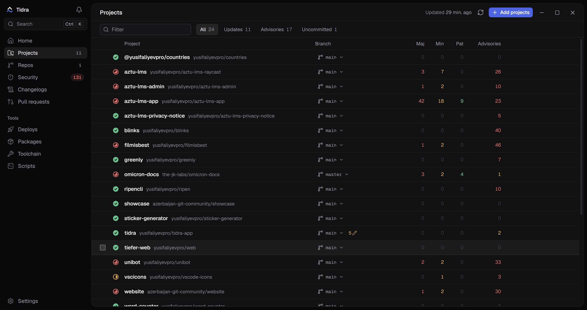

<p align="center">
  
</p>

<p align="center">Keep every project you maintain up to date, from one desktop app.</p>

<p align="center">
  <a href="https://github.com/yusifaliyevpro/tidra-app/releases/download/v1.0.0/Tidra_1.0.0_x64-setup.exe"></a>
  <a href="https://github.com/yusifaliyevpro/tidra-app/releases/download/v1.0.0/Tidra_1.0.0_universal.dmg"></a>
  <a href="https://github.com/yusifaliyevpro/tidra-app/releases/download/v1.0.0/Tidra_1.0.0_amd64.AppImage"></a>
</p>

<p align="center">
  <sub>
    Windows x64 · macOS (Apple silicon and Intel) · Linux x64:
    <a href="https://github.com/yusifaliyevpro/tidra-app/releases/download/v1.0.0/Tidra_1.0.0_amd64.deb">.deb</a>,
    <a href="https://github.com/yusifaliyevpro/tidra-app/releases/download/v1.0.0/Tidra-1.0.0-1.x86_64.rpm">.rpm</a>,
    <a href="https://github.com/yusifaliyevpro/tidra-app/releases/latest">all releases</a>
  </sub>
</p>

---

Tidra watches the projects on your machine and tells you what needs attention: outdated dependencies, what changed upstream, security advisories, failing CI, pull requests waiting for you, and broken deploys. When it's time to update, it edits your manifests, installs and runs your checks, then you review and commit with one click, without opening an editor.

The name comes from _tide_: the steady stream of upstream releases your projects have to keep up with. The logo is the two version range symbols from `package.json`: the `^` (caret) on top and the `~` (tilde) wave below.

<p align="center">
  
</p>

> Status: early development. Not ready for daily use yet.

## Install

Download the installer for your system with the buttons above. Tidra updates itself after that: it checks for a new version at launch and every few hours, and "Update to x.y.z" appears next to the search box. On Linux the AppImage updates in place; the `.deb` and `.rpm` update too, but ask for your password to install.

The installers are not code-signed yet, so the first launch shows a warning:

- **Windows**: SmartScreen says "Windows protected your PC". Click **More info**, then **Run anyway**. The installer sets Tidra up for your user only, without an administrator prompt.
- **macOS**: open the `.dmg` and drag Tidra to Applications. If macOS says Tidra can't be opened, go to **System Settings → Privacy & Security** and click **Open Anyway**. If it says the app is damaged, run `xattr -cr /Applications/Tidra.app` in Terminal once.
- **Linux**: make the AppImage executable (`chmod +x Tidra_*_amd64.AppImage`) and run it, or install the `.deb` / `.rpm` from the links above.

## Features

- **Projects**: add folders, see branch, local changes and outdated packages grouped by major / minor / patch. Pick updates, Tidra installs them on your branch (or a new one, per project), runs your `check` script (or typecheck / lint / test), and leaves the commit to you.
- **Changelogs**: release notes between the version you have installed and the latest, with breaking changes flagged.
- **Security**: advisories for your installed dependency tree, with a "would fail CI" badge that mirrors `pnpm audit --prod --audit-level high`, and one-click fixes.
- **GitHub Actions versions**: outdated `uses:` refs in your workflows, updated the same way as packages.
- **Dependency search** in the command palette: which projects use a package, at which versions; update it everywhere in one go.
- **Git overview**, **GitHub inbox**, **CI status**, **Dependabot / Renovate PRs**.
- **Deploys** (Vercel, Netlify, Cloudflare Pages), **My packages** (npm downloads, stars, issues), **Toolchain** updates, **Scripts and ports**.
- **AI summaries** of breaking changes with your own API key (optional).
- **Sync** across devices through your own Turso or Supabase database, end-to-end encrypted with your vault password (optional).
- Tray icon, background checks, native notifications, global hotkey, Ctrl+K command palette (configurable).

Works with pnpm, npm, yarn (classic and berry) and bun projects, including workspaces and pnpm catalogs.

## Privacy

There is no Tidra server and no telemetry. Tokens you add are stored in your operating system's keychain. If you turn on sync, everything is encrypted on your device before it leaves; your database only ever sees ciphertext.

## Development

Requirements: Node 24+, pnpm 12, Rust (stable), and the [Tauri prerequisites](https://tauri.app/start/prerequisites/) for your OS.

```bash
pnpm install
pnpm dev        # desktop app with hot reload
pnpm web        # UI only, in the browser, with mocked native calls
pnpm test
pnpm fmt && pnpm check
```

See [AGENTS.md](AGENTS.md) for architecture and [STYLE.md](STYLE.md) for conventions.

## License

[AGPL-3.0-or-later](LICENSE)
